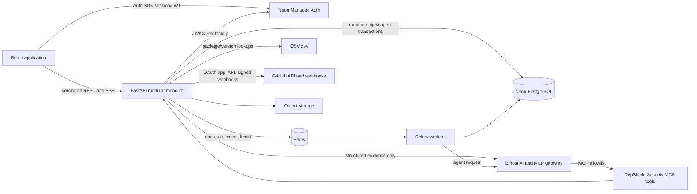
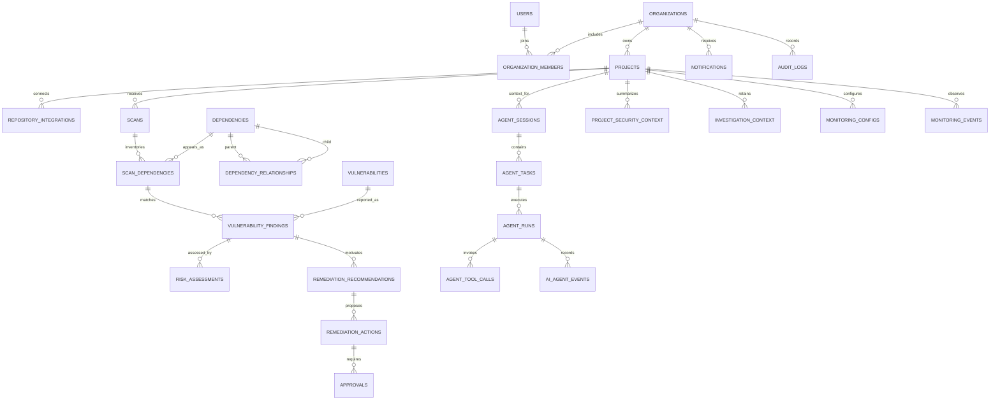

# DepShield AI Architecture

**Status:** Authenticated workspace, persisted tenant data, and npm CLI milestone implemented; Neon schema/Auth endpoint verified; live CLI/Auth/Bifrost flows remain unverified  
**Last reviewed:** 2026-11-11

This document records decisions for the hybrid autonomous and interactive security agent. It
distinguishes implemented code from the target architecture; diagrams and decisions are not evidence
that planned infrastructure or external integrations are deployed.

The npm-first developer CLI, browser-consented local login, normalized inventory/preflight APIs,
and foreground monitor are described in [developer-integration.md](./developer-integration.md).
They are implemented but not published or live-tested against Neon; the Python adapter,
GitHub/CI, VS Code, and automatic remediation remain future work.

## Architecture decisions

1. Start as a modular monolith. FastAPI owns identity enforcement, domain workflows, durable
   business state, investigation history, and approval policy. Workers share domain services and
   database models; split services only when measured scale or independent operations require it.
2. PostgreSQL on Neon is the source of truth. SQLAlchemy models and Alembic migrations manage
   schema evolution; application startup must never create production tables.
3. Use Neon Managed Auth (Better Auth) because the project had no existing identity provider. The
   API verifies EdDSA JWTs against the configured JWKS URL and requires the Auth origin as issuer
   and audience. DepShield's own database remains authoritative for organization membership and
   project authorization.
4. Redis is transient infrastructure for Celery queues, rate limits, short-lived coordination, and
   advisory caching. It is not the system of record.
5. Bifrost is the only model gateway. It routes model requests, handles provider configuration and
   gateway-level observability. DepShield remains responsible for authorization, task state,
   evidence, approval policy, and a durable audit timeline.
6. Start with Bifrost's OpenAI-compatible chat endpoint and explicit application approval of
   proposed MCP calls. Bifrost documentation describes explicit execution as the default. Do not
   turn on broad automatic tool execution. Use OpenAPI-generated MCP tools only after reviewing the
   current gateway version because that feature is documented as beta.
7. Security facts are deterministic. OSV and other authoritative feeds establish advisories and
   affected/fixed ranges. AI can explain supplied evidence but cannot create or verify a finding.
8. The first AI milestone is read-only and requires authenticated project membership. The API
   persists investigation state and evidence events before returning. Repository writes always
   require a separate explicit approval.
9. Do not use LangGraph yet. A narrow, persisted task state machine and Bifrost's documented
   request/tool-execution flow meet the initial needs with fewer moving parts. Re-evaluate only if
   branching/replay requirements exceed that workflow.

## System architecture



### Hybrid agent flows

```mermaid
sequenceDiagram
  participant U as Developer
  participant API as DepShield API
  participant DB as Neon
  participant OSV as OSV
  participant B as Bifrost
  participant T as Security tools

  U->>API: Investigate finding (authenticated project scope)
  API->>DB: Verify membership and load scan evidence
  API->>OSV: Re-verify package/version/advisory
  OSV-->>API: Authoritative advisory data
  API->>DB: Persist task and evidence event
  API->>B: Ask for explanation grounded in verified evidence
  B-->>API: Answer or proposed typed tool calls
  API->>API: Validate tool allowlist, schema, project scope and risk
  API->>DB: Append decision/tool/result events
  API-->>U: Evidence, AI explanation, run ID and current state
  Note over API,T: Read-only tools may run under policy; write tools require approval
```

```mermaid
sequenceDiagram
  participant GH as GitHub
  participant API as Webhook API
  participant DB as Neon
  participant R as Redis/Celery
  participant W as Monitoring worker
  participant OSV as OSV
  participant B as Bifrost
  participant U as Developer

  GH->>API: Signed push/manifest event
  API->>API: Verify signature, repository binding and event type
  API->>DB: Insert idempotent event/outbox row
  API->>R: Enqueue event ID
  R->>W: Deliver with bounded retry
  W->>DB: Claim project lock; load prior inventory
  W->>OSV: Recheck changed/new package versions
  OSV-->>W: Advisory evidence
  W->>DB: Persist scan, findings, risk and event timeline
  W->>B: Investigate eligible findings using evidence
  W->>DB: Persist proposed remediation and approval request
  W-->>U: Notification; no repository write without approval
```

## Backend boundaries

| Module | Owns | Must not own |
|---|---|---|
| `auth` / `organizations` | JWT verification, memberships, roles, project authorization | Advisory truth |
| `projects` / `integrations` | Projects, repository bindings, GitHub OAuth/token lifecycle | Arbitrary repository execution |
| `dependencies` | Ecosystem adapters, lockfile parsers, normalized package inventory and graph | AI-derived package facts |
| `vulnerabilities` | OSV/GitHub advisory clients, normalization, cache policy and affected/fixed ranges | Project authorization |
| `scanning` | Scan lifecycle, inventory correlation, findings and deterministic preliminary severity | LLM vulnerability decisions |
| `risk` | Reproducible severity/context score with component factors and evidence | Unsupported reachability claims |
| `agents` | Task state machine, prompts, Bifrost client, typed tool registry, retries/timeouts and audit events | Durable state in chat history |
| `remediation` | Candidate updates, compatibility evidence and approval state | Silent repository changes |
| `monitoring` / `notifications` | Schedules, webhook event processing, idempotency and delivery status | Duplicate unrestricted rescans |
| `reports` | Tenant-scoped queries and exports | Cross-tenant aggregation |
| `database` / `workers` | Transactions, migrations, queues and outbox consumers | Business policy hidden in infrastructure |

### Dependency direction

`api -> application services -> domain contracts`  
`integrations`, `database`, and `workers` implement ports consumed by application services.
Route handlers validate transport schemas and translate errors; they do not contain matching,
authorization, risk, or persistence logic.

## Agent runtime, tools, state, and permissions

The application, not Bifrost or the model, owns investigation identity and workflow state. Each
task has a tenant, project, initiating principal or system trigger, mode (`interactive` or
`autonomous`), status, idempotency key, evidence references, timestamps, and terminal reason.
Each run and tool call is a separate ordered event with policy decision, approval state, bounded
input/output, latency, and gateway trace ID. Redact credentials and avoid retaining full prompts
when evidence IDs and a versioned prompt are sufficient.

Initial tool registry specification:

| Tool | Purpose | Permission | Execution |
|---|---|---|---|
| `extract_dependencies` | Parse supported manifests/lockfiles | Project read | Automatic after authorization |
| `get_dependency_tree` | Read persisted dependency edges | Project read | Automatic |
| `lookup_vulnerability` | Query normalized advisory cache/source | Security read | Automatic, rate-limited |
| `verify_affected_versions` | Compare installed version with authoritative ranges | Security read | Automatic |
| `assess_project_risk` | Compute deterministic factors from evidence | Project read | Automatic |
| `generate_remediation` | Propose, never apply, manifest changes | Project read | Automatic proposal |
| `generate_security_report` | Render report from persisted results | Project read | Automatic |
| `analyze_dependency_reachability` | Assess use only when code evidence is available | Repository read | Explicitly label unknown without evidence |
| `create_github_pull_request` | Create a proposed PR | Repository write | Explicit approval, scoped installation token |

Every tool has a strict Pydantic input/output model, a stable name and version, an owner, a
permission scope, timeout, input size limit, and structured result/error. Never expose a generic
shell, arbitrary URL fetch, unrestricted database query, or general file-write tool. Treat tool
descriptions, repository text, manifests, advisory text, and model output as untrusted. Re-check
authorization and validate arguments immediately before execution. Default to Bifrost's manual
tool execution flow; if Agent Mode is evaluated later, auto-execute only individually reviewed,
read-only tools and pin the Bifrost version.

## Database ERD

The current database foundation implements organizations, memberships, projects, investigations,
and ordered investigation events. The remaining entities below describe the target model and are
not all present in the current migrations.

Target business entities use UUID primary keys and UTC `created_at`/`updated_at` timestamps where
applicable. Tenant-owned rows carry `organization_id`; child objects also carry their parent ID
so access can be checked in one scoped query. Add composite unique constraints and indexes on
tenant/foreign-key/time and status/queue columns. Use `ON DELETE RESTRICT` for audit/evidence and
explicit soft deletion or retention workflows for projects and users. The initial migration uses
UUID-formatted string IDs and integer event sequence IDs; it does not yet implement retention.



Additional tables and constraints:

- `users`: unique external auth subject; no locally stored password. The current implementation
  stores the Managed Auth subject directly on memberships instead of mirroring user rows.
- `organizations`, `organization_members`: unique `(organization_id, user_id)`; current roles are
  `owner`, `admin`, and `member`.
- `projects`: unique `(organization_id, slug)`; repository identifiers unique per installation.
- `repository_integrations`: encrypted secret references, never token plaintext in general rows.
- `dependencies`: normalized package identity unique by `(ecosystem, canonical_name)`.
- `dependency_relationships`: unique `(scan_id, parent, child, dependency_kind)`.
- `scans`: unique request/idempotency key per project; status, trigger, parser/intel versions.
- `scan_dependencies`: unique `(scan_id, dependency_id, source_locator)`, directness and pin state.
- `vulnerabilities`: unique `(source, source_id)` with source revision and raw evidence location.
- `vulnerability_findings`: unique `(scan_dependency_id, vulnerability_id)`.
- `risk_assessments`: immutable algorithm version and factor snapshot per finding.
- `agent_sessions`, `agent_tasks`, `agent_runs`, `agent_tool_calls`, `ai_agent_events`:
  immutable sequence numbers, idempotency, state transitions and trace IDs.
- `project_security_context`, `investigation_context`: source references, retention and freshness;
  never treat vector/summary context as authoritative over current scan records.
- `remediation_recommendations`, `remediation_actions`, `approvals`: approval principal, scope,
  expiry and exact proposed diff hash.
- `monitoring_configs`, `monitoring_events`, `notifications`, `audit_logs`: delivery/retry state,
  external event IDs, dedupe keys, actor and decision outcomes.

Apply PostgreSQL row-level security in addition to service-level scoped authorization. Set the
authenticated organization context transaction-locally; never accept an organization ID as proof
of access from a request body. Test cross-tenant access with separate memberships. The current
implementation uses explicit membership joins and scoped queries, but does not yet enable RLS.

## API contracts

All new REST routes live under `/api/v1`; the current `/api/scans` route is a prototype compatibility
route and should be removed after the frontend migrates. OpenAPI is generated from FastAPI schemas.
List endpoints use cursor pagination (`limit`, `cursor`), validated filters, and a common error
envelope `{ "error": { "code": "...", "message": "...", "request_id": "..." } }` in the target
API. Current FastAPI endpoints use their standard `detail` error response and bounded `limit`
pagination where applicable.

| Method and route | Contract |
|---|---|
| `GET /api/v1/organizations` | List the caller's organizations and roles |
| `POST /api/v1/organizations` | Create an organization and become its owner |
| `GET /api/v1/organizations/{organization_id}/projects` | List projects after membership check |
| `POST /api/v1/organizations/{organization_id}/projects` | Create a project as owner/admin |
| `POST /api/v1/projects/{project_id}/scans` | Start authorized scan; return `202` and scan ID |
| `GET /api/v1/scans/{scan_id}` | Status and timestamps after project authorization |
| `GET /api/v1/scans/{scan_id}/results` | Findings and inventory, paginated/filterable |
| `POST /api/v1/agent/investigations` | Start a project-scoped investigation and persist its result/events |
| `GET /api/v1/agent/projects/{project_id}/investigations` | List the caller's project-scoped investigation history |
| `GET /api/v1/agent/investigations/{investigation_id}` | Read an investigation and ordered event timeline |
| `GET /api/v1/agent/tasks/{task_id}` | Authorized task status/result |
| `GET /api/v1/agent/tasks/{task_id}/events` | Replayable events/SSE after `Last-Event-ID` |
| `GET /api/v1/vulnerabilities` | Tenant-visible findings with severity/package/status filters |
| `POST /api/v1/projects/{project_id}/monitoring` | Configure schedules after role check |
| `POST /api/v1/remediations/{id}/approve` | Explicitly approve exact diff hash; idempotent |
| `GET /api/v1/projects/{project_id}/reports` | Authorized report index |

Use `201` for created resources, `202` for queued work, `401` for missing/invalid identity,
`403` for insufficient scope, `404` to avoid leaking cross-tenant resource existence, `409` for
idempotency/state conflicts, `422` for invalid input, and `429` for rate limits. SSE is read-only;
persist event sequence before publishing so reconnects can replay. Never stream unpersisted
security decisions as the only record.

## Bifrost and investigation strategy

The backend uses Bifrost's OpenAI-compatible `/openai` interface through one `BifrostClient`
abstraction. Server-side settings contain the gateway URL, virtual key, configured model, timeout
and optional fallback routing (configured inside Bifrost); the frontend never receives provider or
virtual keys. Require non-streaming requests for the initial tool loop. Record gateway request ID,
model, latency and usage when supplied; never log credentials.

The gateway documentation states that ordinary tool calls are suggestions until the application
explicitly calls `POST /v1/mcp/tool/execute`. DepShield must inspect tool name, arguments, project
scope, permission, and approval requirement before execution, then append the policy decision and
outcome to its own timeline. Bifrost Agent Mode is optional, version-dependent, non-streaming, and
requires explicit tool allowlists; it is not enabled by default.

The first interactive investigation path is:

1. Authenticate caller; authorize project and finding; load scan evidence from PostgreSQL.
2. Re-query/confirm authoritative advisory data when freshness policy requires it.
3. Build a bounded, typed evidence packet (advisory IDs, affected/fixed ranges and source links).
4. Send question and evidence to Bifrost with instructions to distinguish facts from unknowns.
5. Return the original evidence separately from the AI explanation and label the latter as
   generated. Never accept model output as a vulnerability, affected range, or fix.
6. Persist authorization, investigation, OSV, Bifrost, and completion/failure events with the
   investigation record. The current API is synchronous; queued retries, cancellation, and recovery
   are future work.

### MCP registration strategy

The first server surface is the application's typed, permission-checked security API. Bifrost's
OpenAPI-to-MCP adapter can expose reviewed operations without inventing a proprietary tool
protocol, but the official docs mark this adapter beta. Only allowlist security-read operations in
the initial configuration; never auto-run generated `POST` operations merely because they are
available. If the beta adapter fails security or schema requirements, implement a dedicated
DepShield MCP server and register it with Bifrost's documented HTTP transport.

### Autonomous processing

GitHub webhook ingress verifies HMAC against the exact raw body and validates installation,
repository, event type and delivery ID. Persist the delivery in an outbox transaction before
acknowledging. A Celery worker claims the event with a lease, acquires a per-project lock, and
compares manifest/commit fingerprints to the last inventory. Unique `(provider, delivery_id)` and
task idempotency keys prevent duplicate work. Retry transient provider failures with bounded
exponential backoff and jitter; send exhausted jobs to a dead-letter state for operator review.
Scheduled rescans enqueue only stale projects. Advisory changes select projects from the stored
package inventory instead of rescanning every repository. Worker concurrency is bounded per tenant
and per project.

## Frontend information architecture

Use a responsive application shell with organization/project switcher, global search, accessible
severity system, theme toggle, and a persistent agent activity surface. Planned routes:

```text
/                         marketing landing
/auth/{sign-in,sign-up,forgot-password,reset-password}
/app                      security posture, recent activity, trends and prioritized actions
/app/projects             project list and add/connect/upload flows
/app/projects/:id         overview, inventory, findings, scans, monitoring, reports
/app/vulnerabilities      filterable findings and evidence detail
/app/agent                project-scoped conversation, evidence and persisted tool timeline
/app/remediations         proposals, diffs, compatibility notes and approval state
/app/monitoring           schedules, events, alerts and delivery history
/app/reports              report history and exports
/app/settings             profile, organization, GitHub, AI gateway policy, notifications
```

Design direction: original deep-navy/neutral foundation; restrained emerald, amber, red and blue
status colors; dense but readable security tables; clear empty/loading/error states; keyboard
navigation; reduced-motion support; both dark and light themes. Use Linear-style information
hierarchy, Vercel-style restrained surfaces, and security-product evidence detail as inspiration,
not copied layouts. Current dashboard metrics and sample findings must remain visibly labeled
**demo** until backed by persisted API data. Avoid presenting them as measured security outcomes.

## Security and operations

- Verify Neon Auth JWT issuer, audience, expiry and signing key; map every request to principal,
  organization, role and project permission. Add PostgreSQL RLS as defense in depth.
- Enforce request size/schema limits, per-user/tenant rate limits, secure headers, CSRF policy for
  cookie-authenticated flows, and structured error responses that omit secrets and internal paths.
- GitHub uses least-privilege app installations, short-lived tokens, OAuth state/PKCE, raw-body
  webhook signature verification, replay detection, and explicit repository selection.
- SSRF protection: never fetch arbitrary manifest URLs; egress allowlist known GitHub/OSV endpoints,
  resolve and reject private/link-local addresses where user-configurable URLs are unavoidable.
- Archives are untrusted: validate normalized paths, reject symlinks/zip-slip, impose file/count/
  compression limits, scan in isolated storage/workers, never execute repository code on API hosts.
- Tool calls use allowlisted schemas, project-bound scope, least privilege, timeouts, output limits,
  and audit events. Treat prompt injection as untrusted data; system instructions are not a security
  boundary. Prevent secrets from entering prompts and redact model/tool logs.
- Repository modifications: generate proposed diffs only; require an unexpired approval bound to
  the exact diff hash and repository. No merge or install/build on the main service.
- Use environment/secret manager references for keys. Production requires TLS, backups, migration
  review, structured logs, metrics/traces, retention policy and incident response.

## Proposed monorepo structure

```text
depshield/
├── frontend/
│   └── src/{app,components,features,services,lib,types,styles}/
├── backend/
│   ├── app/
│   │   ├── api/v1/
│   │   ├── core/{config,security,logging,errors}/
│   │   ├── database/{base,session,migrations}/
│   │   ├── models/ schemas/
│   │   ├── modules/{auth,organizations,projects,dependencies,vulnerabilities,
│   │   │   scanning,risk,agents,remediation,monitoring,notifications,reports}/
│   │   ├── integrations/{bifrost,osv,github,storage}/
│   │   └── workers/
│   └── tests/{unit,integration,api,fixtures}/
├── infrastructure/{docker,deployment}/
├── docs/{architecture,api,security,development}/
├── docker-compose.yml
└── .env.example
```

The existing small `app/domain/scanning` module can be migrated into these boundaries incrementally;
do not rewrite it before replacement parsers and tests exist.

## Testing and rollout phases

1. **Architecture/foundation:** this document, route contracts, schemas, environment example,
   dependency and migration baseline; review tenant boundaries and external-service failure modes.
2. **Identity/data:** source includes Neon JWT verification, SQLAlchemy/Alembic models,
   organization/project APIs, membership-scoped queries, invitation/member management, and RLS
   policies. A live Neon Auth/database configuration, migration, and PostgreSQL RLS tests remain
   required.
3. **Interactive agent vertical slice:** source includes synchronous evidence-backed investigations,
   persisted event timelines, and stale-run recovery as failure. Live Bifrost configuration,
   queued execution, retries/replay, and approval gates remain future work.
4. **Dependency intelligence:** npm/Python manifest and lockfile version extraction is implemented.
   Dependency-edge graphs, OSV range matching, GitHub Advisory Database normalization, CycloneDX
   output, and broader known-vulnerability fixtures remain future work.
5. **Autonomous monitoring:** signed GitHub webhooks, outbox/idempotency, Redis/Celery workers,
   schedules, event replay, alert delivery and duplicate/restart tests.
6. **Risk/remediation:** explainable deterministic risk factors, patched versions, proposed diff
   generation, compatibility checks in isolated workers, human approval and PR creation.
7. **Frontend product surfaces:** landing, auth, dashboard, projects, findings, agent, remediation,
   monitoring, reports/settings, responsive and accessibility checks.
8. **Production readiness:** rate limiting, threat model, security tests, performance, observability,
   backups, deployment and operational runbooks.

Required gates: parser and range-matching unit tests; API contract/integration tests; JWT/role/
cross-tenant tests; Bifrost request/tool approval tests; webhook signature/replay/idempotency tests;
tool prompt-injection/permission tests; frontend component/API/navigation/accessibility tests; and
end-to-end scan-to-investigation-to-approved-remediation tests. Dependency and SBOM scans run in CI.

## Current implementation and unresolved risks

- Implemented: Neon JWT verification; organization, project, invitation, and membership APIs;
  SQLAlchemy models and Alembic schema; authenticated project scans and scan history; synchronous
  project investigations and event history; npm/Python manifests and supported lockfile parsing;
  and frontend workspace flows for scans, invitations, members, and investigations.
- Implemented: PostgreSQL RLS policies and transaction-local tenant/maintenance context. The live
  migration reached `0002_rls_scans_invitations`, and all tenant tables report RLS enabled and
  forced with policies present. However, both configured database URLs use the owner role with
  `BYPASSRLS`; a rollback-only probe confirmed another user could see a test row through that
  role. The user declined creation of a restricted runtime role, so RLS isolation is not currently
  effective for API connections. The policies are also not a boundary against a holder of a
  non-bypass database credential who can set the custom context values.
- Implemented: hourly maintenance marks investigations running for more than 30 minutes as failed
  (it does not retry them), and removes scans/investigations older than 90 days. Invitations expire
  after seven days and are removed after they have been expired for 90 days.
- Implemented: npm `package-lock.json` v1/v2/v3 and Python Poetry/uv TOML plus `Pipfile.lock` JSON
  parsing. Resolved package versions are checked; dependency-edge graphs are not built. Range
  versions are not submitted to OSV as exact-version findings.
- Local validation completed: 44 backend tests, frontend build and lint, Python dependency check,
  and Alembic upgrade/metadata checks against SQLite. SQLite does not execute or enforce the
  PostgreSQL-specific RLS policies.
- Live Neon/PostgreSQL verification is partial: the new project's migration and RLS policy presence
  were verified, Neon Auth is enabled, and its JWKS endpoint responds. Sign-up/sign-in, JWT-backed
  API requests, persisted tenant workflows, and cross-tenant RLS under a non-bypass role remain
  unverified. No trusted domain is configured; localhost is allowed for development.
- Live Bifrost/provider configuration and an end-to-end request remain unverified. Mocked gateway
  responses do not establish that the external integration is operational.
- Invitations have no email delivery. The invitation API returns a one-time token for manual
  out-of-band sharing; only a hash is stored.
- Investigations execute synchronously. Maintenance converts stale runs to failed but does not
  provide a durable queue, retry/replay API, or worker recovery.
- The public manifest scan route remains stateless and unauthenticated for compatibility.
  Authenticated, persisted scans are available through the project-scoped routes.
- OSV's public endpoint can change or rate-limit; failures must remain explicit and must not be
  presented as clean scans. Requirements parsing is narrower than full PEP 508 resolution.
- Not yet implemented: GitHub integration, Bifrost MCP registration, autonomous workers and
  monitoring, human approval/remediation, production rate limits, dependency graph analysis,
  broad product pages, deployment/operations runbooks, and live integration/security testing.
- Dashboard demo figures are not production measurements.

## References

- [Neon Managed Auth React quickstart](https://neon.com/docs/auth/quick-start/react.md)
- [Neon Managed Auth JWT verification](https://neon.com/docs/auth/guides/plugins/jwt.md)
- [Bifrost OpenAI SDK integration](https://docs.getbifrost.ai/integrations/openai-sdk/overview.md)
- [Bifrost MCP overview and explicit tool execution](https://docs.getbifrost.ai/mcp/overview.md)
- [Bifrost tool execution](https://docs.getbifrost.ai/mcp/tool-execution.md)
- [Bifrost Agent Mode](https://docs.getbifrost.ai/mcp/agent-mode.md)
- [Bifrost OpenAPI-generated MCP servers (beta)](https://docs.getbifrost.ai/mcp/openapi-servers.md)
- [Bifrost gateway setup and local deployment](https://docs.getbifrost.ai/quickstart/gateway/setting-up.md)
