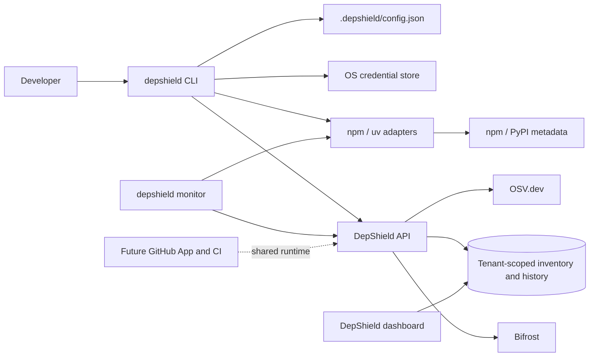

# Developer Integration Layer

**Status:** npm and Python uv adapters are present and locally tested; CLI distribution and hosted/live integration remain unverified  
**Scope:** npm and uv CLI/local monitor; GitHub, CI, and VS Code are later integrations

The first implementation milestone includes the Python CLI package, npm and uv lockfile inventory,
browser-consented login, persisted inventory/preflight APIs, npm and Python `add` gates, foreground
monitoring, and dashboard visibility for current inventory. It is not yet a production-ready
release: Neon runtime RLS bypass, live auth/provider validation, private-registry authentication,
offline queueing, and cross-platform process tests remain unresolved.

This design extends DepShield's existing FastAPI, Neon/PostgreSQL, OSV, and Bifrost application.
It does not treat the CLI as a separate scanner or give the local agent authority to run arbitrary
commands. The backend remains the source of truth for project identity, policy, investigations,
and dashboard history.

## Goals and non-goals

### Goals

- Give developers a dependable, explicit path to check a dependency before adding it:
  `depshield add <package>[@version]`.
- Initialize a local project, identify its package manager, register it to an organization/project,
  inventory its resolved dependencies, and persist the initial assessment.
- Watch only relevant dependency files and synchronize change sets without uploading full source
  trees, manifests, credentials, or package archives.
- Reuse the same advisory and investigation services as dashboard, GitHub webhook, and future
  scheduled workflows.
- Report authoritative security evidence separately from metadata signals and AI-generated
  explanations or hypotheses.
- Fail safely and explainably when required online checks cannot be completed.

### Non-goals for the first implementation

- Intercepting arbitrary `npm install`, `npx`, `pnpm add`, IDE, or script-driven package-manager
  invocations. Developers must use `depshield add` for a pre-install gate.
- Claiming a package is safe because OSV returns no result or because provenance metadata exists.
- Downloading/extracting a candidate package, executing lifecycle scripts, or dynamically
  analyzing package code during preflight.
- Automatic version upgrades or destructive remediation; `add` edits only the selected
  package-manager manifest after approval.
- Shipping the VS Code extension, GitHub App, hosted worker queue, pip/Poetry/Pipenv adapter, or
  additional language/package-manager adapter in the first CLI milestone.

## Proposed component architecture



### CLI distribution and module boundaries

Approved runtime: a lightweight Python package installable with `pipx` and exposed as the
`depshield` executable. Keep command handling, filesystem/configuration, authentication, and
network clients behind interfaces so package-manager integrations remain independent of the CLI
runtime. npm is the first adapter; the initial Python adapter supports uv and its `uv.lock`.

Suggested internal boundaries:

| Component | Responsibility |
|---|---|
| `commands/` | Parse CLI arguments and present human/JSON output; no security policy decisions |
| `project/` | Find project root, read safe config, compute manifest/lockfile digests |
| `adapters/` | Detect package manager, parse installed inventory, resolve candidate metadata, add, verify |
| `api/` | Authenticated API client, request IDs, bounded retries, response validation |
| `auth/` | Browser/device login flow and OS credential-store integration |
| `monitor/` | Watch only supported dependency files, debounce, diff inventory, synchronize |
| `policy/` | Validate the server's versioned decision response and obtain explicit approval |
| `report/` | Render terminal, JSON, or file reports from persisted API results |

Use explicit argument arrays and a fixed executable allowlist for package-manager invocation;
never interpolate package names into a shell command. The npm adapter validates package specs and
rejects aliases, URLs, git dependencies, local paths, and shell-like input unless a later reviewed
feature explicitly supports them.

## CLI command contract

Project commands discover the nearest `.depshield/config.json`. Human output is the default;
`--json` produces machine-readable output. Commands that need a registered project require login
and an online backend. `init` accepts `--project-root`, `--name`, and `--api-url`.

| Command | Contract |
|---|---|
| `depshield init` | Detect npm or Python uv from project files; browser login; select/create organization and project; write non-secret local config; sync full normalized inventory and persist the initial assessment. Requires an existing npm or uv lockfile; never installs. |
| `depshield add <package>` | Resolve an exact candidate from npm or PyPI, call persisted preflight, display evidence/policy, require confirmation for allow/warn, block on an active OSV match, run the selected manager only after approval, verify project state, then synchronize inventory. |
| `depshield scan` | Parse the current npm or uv lockfile without running package-controlled code; sync normalized package names/versions. Backend scans only added/updated versions. |
| `depshield status` | Show project, manager, local dependency count, and latest saved scan; requires the API. Never displays tokens. |
| `depshield monitor` | Poll npm/uv project and lockfiles in the foreground, debounce changes, synchronize stable inventory snapshots, and retry API failures while running. |
| `depshield explain <finding-or-package>` | Fetch a saved investigation by ID or latest matching package name. |
| `depshield fix <finding>` | Safely reports that verified fix candidates are not available; makes no project changes. |
| `depshield report` | Fetch the latest saved scan and print it in human or JSON format. |

Current process codes: `0` success, `1` policy block, `2` check/infrastructure failure or
unsupported remediation, and `4` approval declined. The parser reports argument errors using
`argparse`'s standard exit behavior. `--json` emits machine-readable results; interactive
organization selection and installation approval remain terminal prompts.

## npm adapter contract

The adapter exposes typed operations and does not own security policy:

```text
detect(root) -> Detection(manager, manifests, lockfiles, confidence)
readInventory(root) -> Inventory(packages, sourceDigests, completeness)
resolveCandidate(root, packageSpec) -> Candidate(exactName, exactVersion, registry, metadata)
add(root, candidate, options) -> InstallResult(exitCode, stdoutSummary, stderrSummary)
verify(root, candidate) -> Verification(installedVersion, lockfileVersion, consistent)
```

Implemented npm support:

- Detect npm from `package.json`, its `packageManager` field, and npm lockfiles; refuse conflicting
  pnpm/Yarn lockfiles rather than guessing. `npm-shrinkwrap.json` takes precedence over
  `package-lock.json`.
- Parse v1/v2/v3 lockfiles, including nested/scoped dependencies, and retain unresolved version
  strings as unchecked inventory rather than silently dropping them.
- Resolve an omitted version to the configured registry's `latest` tag. Explicit versions must be
  exact semantic versions. Read metadata using bounded HTTP requests; never invoke `npm view`,
  `npm pack`, `npm install`, `npx`, or package-controlled code during preflight.
- Display publish time, deprecation, repository, lifecycle script names, integrity, and provenance
  URL separately as untrusted metadata. Require a registry integrity digest and compare it to the
  resulting lockfile; provenance signatures/identities are not independently verified.
- Private registries requiring credentials are not yet supported during metadata lookup and fail
  closed. Registry URLs must use HTTPS except localhost.
- After allow/warn and explicit interactive approval, invoke npm with argument arrays,
  `--ignore-scripts`, `--save-exact`, and `--global=false`. This implementation suppresses package
  lifecycle scripts for the install too; it does not report that scripts ran.
- Verify exact manifest version, installed package path, direct lockfile version, and integrity
  before syncing inventory. A mismatch prevents sync and is reported as an error.

Implemented Python uv support:

- Detect only projects with both `pyproject.toml` and `uv.lock`; reject mixed npm/Python projects
  and competing Python lockfiles rather than guessing.
- Parse exact package versions from `uv.lock`; exclude editable, directory, and virtual workspace
  packages from the external dependency inventory.
- Resolve an omitted version from PyPI's latest release metadata or a requested exact `==version`.
  The adapter makes bounded HTTPS JSON requests only and does not download distributions or run
  build backends during preflight.
- Record PyPI artifact SHA-256, upload time, source URL, and yanked status as untrusted metadata.
  The fixed policy warns for yanked releases; private indexes and provenance verification are not
  implemented.
- After approval, run `uv add --no-sync` and `uv sync`; the latter may run build backends while
  installing packages. Verify the exact project pin, uv lock version/hash, and installed distribution
  version before synchronizing inventory.
- pip, Poetry, Pipenv, Python workspaces, and projects that combine npm and Python at one root are
  not yet supported. Newly resolved transitive dependencies are inventory-scanned after uv sync,
  not individually preflighted before that first installation.

## Pre-install security gate

1. **Validate locally.** Normalize the package identifier; reject unsupported schemes/aliases.
   Identify the project root and one supported package manager. Do not start a package manager or
   execute package-controlled code.
2. **Resolve candidate.** Query npm or PyPI metadata read-only and resolve one exact version.
   Record registry host, retrieval time, artifact hash, publish time, yanked/deprecation state,
   repository, and provenance observations. Do not fetch candidate packages.
3. **Request server preflight.** Send authenticated project ID, exact ecosystem/name/version,
   registry identity, and selected safe metadata fields.
   Never send the raw manifest, auth token in a body, local environment, source code, or full
   registry document.
4. **Build verified evidence.** The API queries OSV for the exact version. A non-withdrawn match is
   saved as advisory evidence; withdrawn advisories are excluded. No separate malware feed is
   wired. Registry metadata remains an untrusted signal.
5. **Use shared agent runtime selectively.** An OSV match is sent to the existing Bifrost-backed
   explanation path. An AI outage does not erase OSV evidence or change a block decision; the
   response labels the explanation unavailable. AI text never determines policy.
6. **Evaluate policy.** The fixed `default-v1` policy blocks any active OSV match, warns when
   deprecation, lifecycle scripts, a provenance URL, or a yanked release is present, and otherwise
   allows. OSV/API failure is fail-closed. Configurable organization rules and audited overrides are
   not implemented.
7. **Present before mutation.** Display candidate, metadata, evidence, optional AI explanation, and
   policy. Both allow and warn require interactive confirmation. A block cannot be overridden;
   non-interactive mode and `--yes` are not supported.
8. **Install, verify, synchronize.** Only after allow/warn and confirmation does the adapter invoke
   npm or uv; it verifies manifest/path/version/integrity, then synchronizes the normalized inventory.

`depshield add` can reliably gate only commands routed through this CLI. Plain `npm install`,
`npm i`, `npx`, IDE integrations, and scripts can bypass it. The watcher detects their resulting
manifest/lockfile change after the fact; that is post-install detection, not prevention.

## Project initialization and registration

1. Implementations use the selected project root; they do not recursively traverse source trees,
   `node_modules`, or virtual environments.
2. Detect npm from `package.json`/lockfiles or uv from `pyproject.toml`/`uv.lock`; refuse competing
   managers. Workspaces and mixed npm/Python roots are not yet supported.
3. Browser login uses an explicit dashboard consent page and a random-state loopback callback.
   The token is stored through `keyring` in the OS credential store. This is not a scoped device
   credential, and expiry/revocation lifecycle management remains future work. Secure-storage
   failure is reported; the CLI does not fall back to a config file or terminal token argument.
4. Select an existing organization or create one through the authenticated API; reuse a same-named
   project or create it. Store API URL and organization/project IDs in the ignored
   `.depshield/config.json`; no token or database/provider secret is stored there.
5. Require the selected npm or uv lockfile, send only normalized names and version strings, persist
   the first snapshot, and trigger an initial assessment. Initialization never runs install.

## Local monitoring and synchronization

- `depshield monitor` is an opt-in foreground process, not a silently installed service. A later
  installer may offer login-startup registration with explicit consent and uninstall instructions.
- The foreground implementation polls npm/uv project files and competing manager lockfiles once
  per second, debounces for 500 ms, and synchronizes a stable full normalized inventory. The server
  compares snapshots and queries OSV only for new/updated package versions; removals update the
  stored snapshot without an unnecessary advisory scan.
- This initial monitor has no durable offline queue or filesystem watcher. API failures retry while
  the process remains open (at a five-second interval); restart recovery and synchronization
  cursors are not implemented. Ordinary package-manager changes are detected only after the
  manifest/lockfile changes.
- `status` requires the API and shows local manager/lockfile plus saved scan history. Offline mode
  is not presented as a completed security check; `add` fails closed when metadata, OSV, policy, or
  API requests fail.

## Backend API and shared runtime changes

Keep all work behind current membership/tenant authorization. Implemented API capabilities:

| API capability | Purpose |
|---|---|
| Browser callback authorization | Consent from an existing dashboard session; token stored in the OS credential manager; no device-code/revocation API |
| Project registration | Uses existing organization/project endpoints; same-named project is reused |
| Initial/current inventory | `PUT /api/v1/projects/{id}/inventory`; normalized npm/uv snapshot stored with revision and digest |
| Package preflight | `POST /api/v1/agent/preflight`; npm/PyPI OSV evidence, metadata and decision are persisted as an investigation |
| Incremental security scan | Backend compares the full submitted snapshot and queries OSV only for added/updated versions |
| Dashboard inventory | `GET /api/v1/projects/{id}/inventory`; current snapshot is visible in the workspace |
| Explain/status/report | Reuses saved investigation and scan history endpoints |

Future work should refactor the current route-owned scan/investigation logic behind shared application services:
`InventoryService`, `AdvisoryService`, `PreflightService`, `PolicyEvaluator`,
`InvestigationService`, and `InventorySyncService`. Dashboard, CLI, webhooks, CI, and scheduled
triggers call these same services; they must not implement independent vulnerability verdicts.
CLI-originated runs/events record actor, project, source (`cli`, `monitor`, `dashboard`, `github`,
`schedule`, `ci`), adapter/version, correlation ID, idempotency key, evidence references, policy
revision, and outcome. Dashboard history remains project-scoped and labels source correctly.

The inventory and preflight APIs are synchronous. No malware feed is wired. The hosted Neon
runtime role still has `BYPASSRLS`; do not send tenant CLI traffic there until a restricted role
and cross-tenant RLS are verified.

## Package-manager adapters

Implement and validate one adapter at a time; the common interface never implies equivalent
security semantics across tools.

| Adapter | Planned scope |
|---|---|
| npm (first) | `package.json`, npm lockfile v1/v2/v3, registry metadata, exact-version `npm install`, post-install verify |
| Python uv | `pyproject.toml`/`uv.lock`, PyPI metadata, exact version `uv add` and `uv sync` only after approval |
| pnpm | `pnpm-lock.yaml`, workspace-aware resolution and add command; explicitly handle build-script policy |
| Yarn | Yarn Classic and Berry lock formats via separately tested parsers; plugin/constraint behavior is not assumed |
| Rust | `Cargo.toml`/`Cargo.lock`, crates.io metadata, `cargo add` semantics |
| Go | `go.mod`/`go.sum`, module proxy metadata, `go get` behavior |

Every adapter must expose detection confidence, parser completeness, exact resolution semantics,
actual install behavior, script/build execution behavior, verification, and failure modes. If a
manager is not implemented or a lockfile format is unknown, the CLI must refuse pre-install
claims and provide an explicit manual scan option; it must not fall through to a shell command.

## Failure handling and offline semantics

| Failure | Required behavior |
|---|---|
| Missing login/project permission | Do not upload inventory or install; explain login/reselection |
| Ambiguous manager/workspace | Ask for explicit selection; do not guess |
| Registry unavailable or version cannot be resolved | Preflight incomplete; no installation |
| OSV/required intelligence unavailable | Mark the check incomplete and fail closed; an override workflow is not implemented |
| Bifrost unavailable | Preserve verified facts and allow policy evaluation; label AI explanation unavailable |
| Auth/backend timeout or 429/5xx | Bounded exponential retry with jitter for idempotent operations; never repeat package installation blindly |
| Install command fails/partially mutates | Preserve output summary/exit status, inspect actual state, sync if safe, and never retry automatically |
| Install result differs from preflight version | Mark preflight mismatch, scan actual lockfile resolution, and do not report the candidate as installed/covered |
| Malformed/oversized manifest or metadata | Reject with source and field-level error; do not silently truncate or downgrade |
| Monitor loses filesystem events | Periodic digest reconciliation and explicit stale status |
| Offline `scan`/`status` | Local-only results marked unchecked/stale; no claim of current advisory status |

Do not include full package registry responses, raw process environments, auth material, or entire
manifest contents in logs or telemetry. Redact URLs containing credentials and cap subprocess output.

## GitHub and CI/CD (later phases)

- CI first supports a non-installing lockfile gate before `npm ci`: scan the committed resolved
  inventory and fail according to policy. This is separate from the local `depshield add` flow.
- GitHub App/webhook events update the same inventory and persisted investigations after reviewed
  dependency/lockfile changes. Use signed webhooks, repo binding, idempotency, and least-privilege
  installation tokens.
- CI and GitHub report policy outcome and evidence links. They must not treat a model-generated
  hypothesis as a verified vulnerability or modify dependencies without an approved PR workflow.
- VS Code extension is a later presentation/client surface over the same CLI/API contracts; it does
  not introduce another scanner or policy engine.

## Testing and rollout status

1. **Contracts and threat model:** architecture and core safe defaults are documented. Product
   policy customization, revocation, idempotency, and tenant RLS deployment remain open.
2. **Backend persistence:** npm/uv inventory snapshot, incremental OSV scan, npm/Python preflight persistence,
   membership checks, and migration `0003_project_inventory` are implemented. Local SQLite tests
   do not verify hosted PostgreSQL RLS.
3. **CLI/auth:** Python `pipx` package, browser consent callback, OS credential-store integration,
   project registration, and npm/uv init/scan/status commands are implemented. Real-browser and
   credential-store integration tests remain outstanding.
4. **npm preflight/add:** bounded metadata lookup, OSV/policy decision, Bifrost explanation,
   approval gate, script-disabled install, integrity/version verification, and inventory sync are
   implemented. No real registry/install round trip has been tested.
5. **Monitor/reports:** foreground polling, delta-aware backend sync, explain/report, and dashboard
   inventory display are implemented. There is no durable offline queue, filesystem watcher, or
   automatic fix candidate.
6. **Python uv adapter:** bounded PyPI metadata, yanked-release warning, preflight gate, uv add/sync,
   lock/hash/version verification, and inventory sync are implemented. No real PyPI/uv install
   round trip has been tested. pip, Poetry, and Pipenv remain future adapters.
7. **GitHub/CI/VS Code:** later integration phases; no hooks/webhooks or automated remediation are
   currently implemented.

Required tests:

- Unit/conformance tests per adapter for detection, malformed input, workspaces, exact candidate
  resolution, transitive inventory, and verification.
- Integration tests with temporary project roots and mocked registry/OSV/API/Bifrost; no network
  dependency for the deterministic suite.
- Command-order tests prove preflight never invokes package installation, scripts, tarball
  extraction, or arbitrary shell, and installation occurs only after policy and approval.
- Security tests for shell metacharacters, option injection, path traversal/symlinks, hostile
  package metadata, prompt injection in advisory descriptions, oversized responses, token/config/
  log leakage, API tenant isolation, replay, and request idempotency.
- Watcher tests for rapid saves, atomic rename, missing events, manager changes, lockfile churn,
  ignored paths, offline/online transitions, duplicate notifications, and queue recovery.
- End-to-end tests for `init -> inventory -> dashboard history`, `add -> preflight -> decision ->
  approval -> install -> exact verification -> sync`, and external `npm install -> monitor detects
  after installation`.
- Windows, macOS, and Linux smoke tests for credential store, process invocation, filesystem
  events, paths, signals, and exit codes.

## Known limits before production expansion

- **Authentication lifecycle:** the CLI reuses an existing Neon Auth session token. Secure local
  storage is implemented, but scoped device credentials, refresh, revocation, and hosted callback
  verification are not.
- **RLS is not effective for the configured runtime database URLs.** They use an owner role with
  `BYPASSRLS`; do not use hosted CLI tenant traffic until a restricted role is configured and
  cross-tenant RLS is tested.
- **Policy is fixed:** any active OSV match blocks, selected metadata signals warn, and AI never
  decides. Configurable organization rules, overrides, and additional authoritative malware feeds
  are not implemented.
- **Registry provenance is not malware proof.** The CLI displays an attestation URL but does not
  verify its signature or identity. Private registry authentication is unsupported and fails closed.
- **Installation behavior:** no install script runs during preflight. The CLI also passes
  `--ignore-scripts` to npm after approval, which may prevent legitimate native build steps.
- **Ordinary package-manager commands remain bypassable.** Prevention applies only to
  `depshield add`; monitor detects external installs only after manifest/lockfile changes.
- **Synchronous limits:** OSV checks run inline and inventories are capped at 1,000 packages.
  Larger-scale work needs durable jobs, idempotent retry, and outbox/worker processing.

## References

- [Current DepShield architecture](./architecture.md)
- [Neon Managed Auth overview](https://neon.com/docs/auth/quick-start/react.md)
- [npm CLI documentation](https://docs.npmjs.com/cli/)
- [OSV API](https://google.github.io/osv.dev/api/)
- [Bifrost gateway setup](https://docs.getbifrost.ai/quickstart/gateway/setting-up)
- [Bifrost governance and virtual keys](https://docs.getbifrost.ai/features/governance/virtual-keys)
